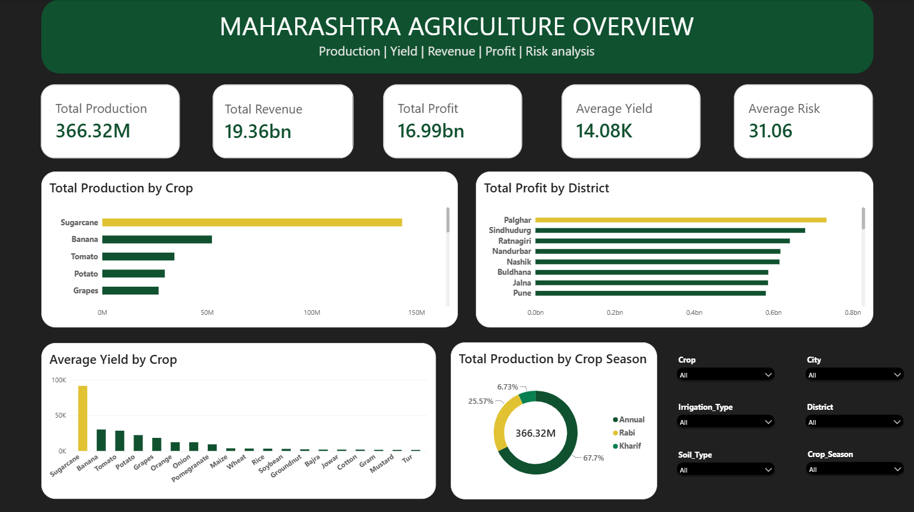

# Maharashtra Agriculture Dashboard (Power BI)

## Overview

This project is an interactive Power BI dashboard that analyzes Maharashtra agricultural data, including crop production, yield, revenue, profit, and risk.

## Dashboard Preview

## Features

- Total Production Analysis
- Total Revenue Analysis
- Total Profit Analysis
- Average Yield Analysis
- Average Risk Analysis
- Total Production by Crop
- Total Profit by District
- Average Yield by Crop
- Seasonal Production Analysis
- Interactive Filters for Crop, City, District, Soil Type, Irrigation Type, and Crop Season

## KPIs

- Total Production: 366.32M
- Total Revenue: 19.36bn
- Total Profit: 16.99bn
- Average Yield: 14.08K
- Average Risk: 31.06

## Tools Used

- Power BI
- DAX
- Power Query

## Analysis Modules

- `01_data_quality_analysis` — Data cleaning and quality checks
- `02_exploratory_data_analysis` — Agricultural trends and patterns
- `03_statistical_analysis` — Statistical analysis of agricultural data
- `04_feature_engineering` — Data preparation for crop-yield analysis and recommendations

## Files

| File | Description |
|---|---|
| `Agriculture Dashboard.pbix` | Power BI report |
| `dashboard.png` | Dashboard screenshot |
| `README.md` | Project documentation |
| `01_data_quality_analysis` | Data quality analysis |
| `02_exploratory_data_analysis` | Exploratory data analysis |
| `03_statistical_analysis` | Statistical analysis |
| `04_feature_engineering` | Feature engineering |

## Objective

To analyze agricultural data and provide insights that support crop-yield analysis and informed crop recommendations.